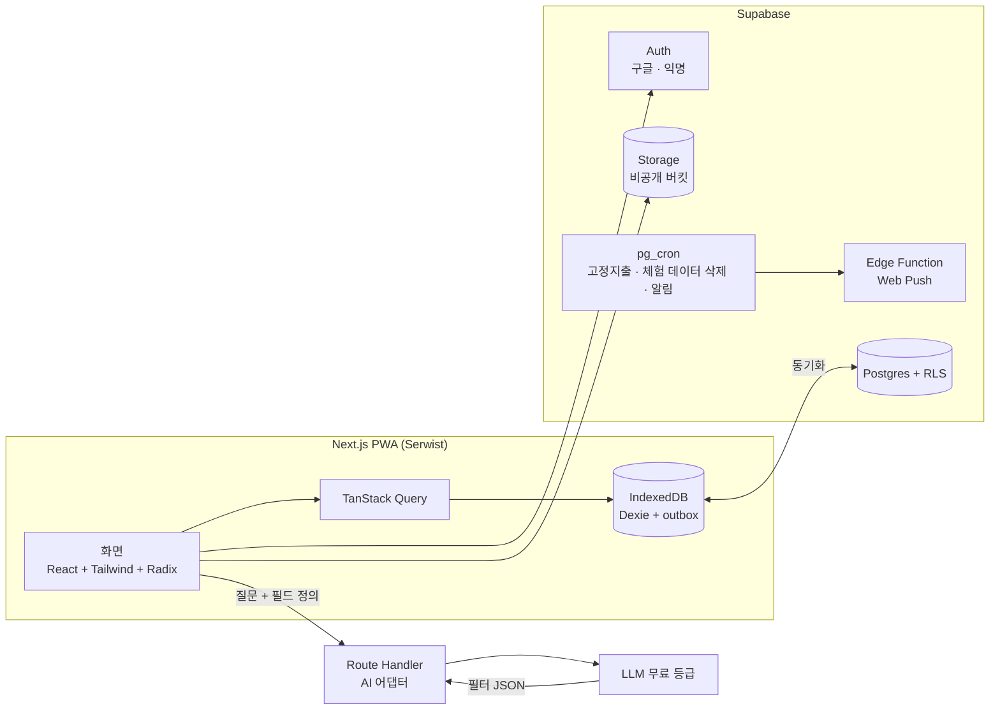

# nanaki

> **나는 나를 키운다.** 가계부·후기·운동·루틴·체형을 하나의 캘린더에 기록하고, 검색·필터와 AI 질문으로 다시 찾아보는 자기관리 PWA

**[배포 주소](https://nanaki-two.vercel.app)** · **[로그인 없이 체험하기](https://nanaki-two.vercel.app/login)** · **[디자인 시스템 페이지 `/design-system`](https://nanaki-two.vercel.app/design-system)**

<!-- TODO: 실제 앱 캡처로 교체 (모바일 라이트 / 모바일 다크 / PC) -->
| 모바일 · 라이트 | 모바일 · 다크 | PC |
| :---: | :---: | :---: |
| _캡처 예정_ | _캡처 예정_ | _캡처 예정_ |

기획, 디자인, 개발, 배포까지 혼자 진행한 프로젝트입니다. **step1을 마쳤고**(2026-10-21, [기록](docs/milestones.md)), 각 step이 끝날 때마다 배포된 상태를 유지합니다.

---

## 목차

1. [왜 만들었나](#왜-만들었나)
2. [주요 기능과 진행 현황](#주요-기능과-진행-현황)
3. [기술적 고민과 해결](#기술적-고민과-해결)
4. [아키텍처](#아키텍처)
5. [기술 선택 근거](#기술-선택-근거)
6. [성능 개선](#성능-개선)
7. [테스트와 CI/CD](#테스트와-cicd)
8. [디자인 시스템](#디자인-시스템)
9. [실행 방법](#실행-방법)
10. [문서](#문서)

---

## 왜 만들었나

지출은 가계부 앱에, 맛집 후기는 메모장에, 운동과 체중은 또 다른 앱에 흩어져 있으면 "지난달 외식에 얼마 썼지?", "운동 시작하고 체중이 얼마나 변했지?" 같은 질문에 답하기 어렵습니다.

nanaki는 서로 다른 생활 기록을 **하나의 공통 데이터 모델**에 모아 한 캘린더에서 보고, 검색·필터와 AI 질문으로 다시 꺼내 볼 수 있게 만드는 것을 목표로 합니다.

## 주요 기능과 진행 현황

| step | 기능 | 상태 |
| --- | --- | --- |
| step1 | 구글 로그인, 로그인 없이 체험하기(익명 로그인 + 샘플 데이터), 가계부·후기 CRUD, 홈 캘린더, 기록 탭, 설정(타입 켜기/끄기, 계정 삭제), 반응형, 다크모드, CI/CD, 화면 비교 테스트, RLS 사용자 격리 테스트 | ✅ 완료 |
| step2 | 운동·루틴·체형 기록, 검색·필터, 오프라인 작성과 동기화, 캘린더·초기 로딩 성능 개선, Lighthouse CI, 에러 모니터링(Sentry) | ✅ 완료 (2026-10-22, [기록](docs/milestones.md#step2-2026-10-21--2026-10-22)) |
| step3 | AI 챗봇 **나키**, 가계부 카테고리별 예산·고정지출, 루틴 푸시 알림 | ✅ 완료 (2026-10-23, [기록](docs/milestones.md#step3-2026-10-23)) |
| step4 | 눈바디(모바일 촬영 가이드, PC 불러오기·맞춰 자르기, 비교 슬라이더), 보고서 PDF, 백업 파일 저장하기/불러오기, 기록 1만 건 성능 개선 | 🚧 진행 중 (사진 저장소, 체형 기록 쓰기·상세에 정면·측면 사진, 지난 사진을 겹쳐 맞춰 자르기, 휴대폰은 실루엣·타이머가 있는 앱 안 카메라, 두 날짜 사진을 손잡이로 겹쳐 보는 눈바디 비교, 후기 사진 최대 5장, 백업 파일 저장하기·불러오기, 기간을 골라 타입별로 요약하는 보고서와 브라우저 인쇄로 PDF 저장) |

**기록 타입 5가지** (설정에서 각각 켜고 끌 수 있고, 꺼도 데이터는 지우지 않고 숨깁니다)

- **가계부**: 지출만 기록합니다. 분류, 결제수단, 고정지출(매달 n일), 카테고리별 예산
- **후기**: 대상 종류(장소·제품·콘텐츠·경험), 별점, 사진(선택, 최대 5장, 원본 비율 그대로 — 눈바디와 같은 압축·위치 정보 제거·비공개 저장)
- **운동**: 종목(직접 입력 가능), 시간, 거리(선택). 전문 운동 앱이 아니라 일상 기록이라 세트·무게·횟수는 넣지 않았습니다
- **루틴**: 요일/매달 반복, 체크형·횟수형 목표, 달성률, 알림 시간
- **체형**: 체중 · 허리둘레 · 눈바디 사진(정면·측면) 중 1개 이상. 같은 날 둘 다 재면 한 기록에, 사진만 찍은 날은 "눈바디" 기록이 됩니다. 태그·메모는 쓰지 않습니다. 사진만 있는 기록에서 마지막 사진을 지우면 기록도 함께 지워집니다(확인 창)

**범위에서 뺀 것**: 건강앱 연동(웹에서 불가), 수입 기록, 카카오 로그인·자체 회원가입, 다국어

## 기술적 고민과 해결

> 각 항목은 구현을 마치면 "문제 → 해결 → 결과" 순서로 보강하고, 관련 PR과 트러블슈팅 문서를 연결합니다.

### 1. 성격이 다른 5개 타입을 하나의 모델로

**문제**: 타입마다 테이블·폼·필터·카드 컴포넌트를 따로 만들면 타입이 하나 늘 때마다 모든 화면을 고쳐야 합니다.

**해결**: 공통 `RecordEntry`(날짜·제목·태그·메모)에 타입별 값은 `fields`로 담고, **타입별 필드 스키마 하나**에서 작성 폼, 필터 항목, 목록 카드, AI 조건을 모두 만듭니다. 필드 종류는 number, text, select, boolean, rating, list 6가지입니다.

```ts
const workoutSchema = {
  activity: { kind: 'select', label: '종목', options: ['헬스', '러닝', '요가'], allowCustom: true, filterable: true },
  minutes:  { kind: 'number', label: '시간', unit: '분', aggregatable: true },
  distance: { kind: 'number', label: '거리', unit: 'km', decimals: 1, optional: true },
};
```

**트레이드오프**: `fields`가 자유 형식이라 타입 안전성이 약해집니다. 같은 스키마에서 TypeScript 타입과 Zod 검증을 함께 만들어 보완합니다. 컴포넌트 안에 `if (type === 'expense')` 같은 분기를 두지 않는 것을 규칙으로 둡니다.

**결과**: _구현 후 작성 (예: 새 타입 추가 시 바뀐 파일 수)_

### 2. 반복 규칙은 기록과 분리

루틴, 고정지출, 체형 측정 주기는 모두 "언제 반복되는가"라는 같은 문제입니다. 공통 `Schedule` 구조(`weekly` / `monthly`, 31일이 없는 달은 말일로 처리)를 하나 두고, **기록에는 실제로 일어난 일만** 남깁니다. 고정지출은 서버 예약 작업(pg_cron)이 해당 날짜에 가계부 기록을 만듭니다.

### 3. 날짜가 하루 밀리는 버그를 설계로 막기

기록 날짜(`occurredAt`)를 `Date`나 UTC 타임스탬프가 아닌 **로컬 `'YYYY-MM-DD'` 문자열**로 저장합니다. 한국 시간 자정 무렵 기록이 UTC 변환으로 전날로 밀리는 문제를 원천적으로 피하기 위한 결정입니다.

### 4. 오프라인 우선 동기화 (step2)

- 기준 데이터는 서버이고, IndexedDB(Dexie.js)는 기기 사본과 미전송 대기열(outbox)입니다. 작성은 온라인이어도 먼저 IndexedDB에 저장하고 outbox에 쌓은 뒤, 뒤에서 서버로 보냅니다 (온·오프라인 동작이 같습니다).
- id는 클라이언트에서 UUID로 만들고 id 기준 upsert로 보내, 같은 요청을 다시 보내도 중복 기록이 생기지 않습니다.
- 다른 기기의 변경은 마지막으로 받은 시각 이후 바뀐 기록만 가져오고, 삭제는 소프트 삭제(`deletedAt`)로 함께 내려옵니다.
- 충돌은 마지막 저장 우선이고, 기기 시계가 틀릴 수 있어 `updatedAt`은 서버가 저장할 때 붙입니다.
- step1부터 화면은 기록 저장·조회 함수 한 파일만 부르게 해, step2에서 그 안만 바꿔 오프라인을 붙입니다.
- 동기화 상태는 평소에는 숨기고, 오프라인 배너·미전송 구름 아이콘·실패 시 "다시 시도" 토스트로만 알립니다.

**알고 있는 한계**: 마지막 저장 우선은 기록 전체를 덮어씁니다. 두 기기에서 같은 기록을 고치거나, 오프라인에서 오래 고친 내용이 나중에 올라가면 다른 기기의 더 최근 수정이 사라질 수 있습니다. 개인 기록 앱의 사용 패턴상 필드 단위 병합 대신 이 단순함을 택했습니다.

### 5. 모바일과 PC를 한 코드로

- **브레이크포인트는 콘텐츠 기준**: 768px에서 좌우 배치를 하면 캘린더 한 칸이 너무 좁아져 모바일(768 미만) · 태블릿(768~1023, 접힌 사이드바) · PC(1024 이상, 좌우 배치) 3구간으로 나눴습니다.
- **레이아웃은 CSS, 기기 능력은 JS**: 서버는 화면 너비를 모르므로 레이아웃은 반응형 클래스로만 바꿔 하이드레이션 불일치를 피합니다. 카메라 촬영·스와이프처럼 기기 능력에 따른 기능은 화면이 뜬 뒤 판단합니다. PC에는 웹캠 촬영 대신 사진 불러오기 + 맞춰 자르기를 제공합니다.
- **스와이프는 지름길**: 달·날짜 이동은 버튼과 키보드(방향키, PageUp/PageDown)로도 가능합니다.
- **URL에 상태**: 선택 날짜, 기록 상세(`/records/view?id=`), 검색어·필터를 URL에 둬 모바일 페이지 이동과 PC 목록·상세 나란히 보기가 같은 경로를 씁니다. 기록 id를 경로가 아니라 `?id=`에 두는 이유는 오프라인입니다: 화면 HTML이 기록과 상관없이 한 장이라, 서비스 워커가 저장해 둔 그 한 장으로 한 번도 열지 않은 기록도 엽니다.
- **기기 단위 처리**: 푸시 알림은 기기마다 구독을 저장해 중복·누락을 막고, 로그아웃 시 기기에 남은 기록과 캐시를 지워 공용 PC에서도 안전하게 씁니다.
- **한글 입력**: 조합 중 Enter로 마지막 글자가 두 번 전송되는 문제를 `isComposing`으로 막습니다.

### 6. AI는 조건만 만들고, 계산은 우리가 (step3)

AI 챗봇 **나키**에게 "지난달 외식비 얼마야?"라고 물으면:

1. 질문과 **켜진 타입의 필드 정의(이름·종류·기본 선택지)와 사용자가 만든 분류·태그 이름만** Next.js Route Handler를 거쳐 AI에 보냅니다. 기록 내용(금액·메모·제목·날짜·건수)은 보내지 않습니다. 이름을 보내면 "Ott" 같은 직접 만든 분류를 정확한 조건으로 잡지만, 이름 자체가 민감할 수 있어(예: "병원") 화면에 보내는 범위를 적어 둡니다.
2. AI는 필터 조건과 계산 종류(목록·합계·건수·평균·최고·최저)와 계산할 숫자 칸만 JSON으로 돌려줍니다.
3. Zod로 검증하고, 실패하면 재요청하거나 안내 문구를 보여 줍니다.
4. 허용된 타입·필드·연산자·숫자 칸만 통과시킨 뒤, 검색 화면과 같은 길(로그인 사용자의 기록만 동기화된 기기 사본)로 찾고 합계·건수·평균·최고·최저는 앱이 계산합니다("최저 체중 68.4kg · 10.19 (월)", 최고·최저면 그 기록을 맨 위에). 데이터는 보내지 않고 계산은 기기에서 하므로, 검색창으로는 못 하는 "얼마·몇 번·언제 제일" 질문에 답합니다. 답변마다 AI가 만든 조건을 칩으로 보여 줘 사용자가 확인할 수 있게 하고, "기록 탭에서 이 조건으로 보기"로 검색 화면에 같은 조건을 넘깁니다.

AI 호출은 **어댑터 파일 하나**(Vercel AI SDK + Gemini)로 감싸 제공자를 바꿀 때 그 파일만 고칩니다. 다른 파일에서 AI SDK를 import하면 ESLint가 막습니다. 무료 등급을 쓰므로 하루 호출 횟수를 서버(DB 함수, 관리자 키로만)에서 셉니다: 로그인 계정 10회, 체험 계정 3회, 서비스 전체 200회(숫자는 환경 변수). AI 제공자 쪽 실패는 횟수에서 빼 줍니다.

### 7. 개인정보와 권한

- 모든 테이블과 Storage에 **RLS**를 걸어 본인 데이터만 읽고 씁니다.
- 몸 사진은 기기에서 압축(WebP + 썸네일)한 뒤 **비공개 버킷**에 올리고, 볼 때는 몇 분 뒤 만료되는 임시 링크만 씁니다. AI와 보고서에서는 제외합니다.
- 로그인 없이 체험하기는 Supabase 익명 로그인으로 방문자마다 샘플 데이터를 만들고, 3일 뒤 자동 삭제합니다. 체험 기록은 그 기기에서만 보입니다.
- 로그아웃하면 기기(IndexedDB)에 저장된 기록과 캐시를 지웁니다. 몸 사진은 서비스 워커 캐시에 넣지 않습니다.
- 보고서(기록 탭 📊)는 기기에 저장된 기록으로 계산하고, **사진은 넣지 않습니다**. PDF는 브라우저 인쇄 창의 "PDF로 저장"으로 만듭니다(서버로 보내지 않음).
- 백업 파일(설정 > 데이터, JSON)에는 기록·루틴·예산·고정지출만 담고 **사진은 담지 않습니다**. 불러오기는 지금 기록을 그대로 두고 없는 것만 더합니다(같은 파일을 다시 불러와도 겹치지 않음).
- AI 나키에는 **질문 문장과 사용자가 만든 분류·태그 이름만** AI 제공자(Google)에 전달되고, 기록 내용(금액·메모·제목·날짜)은 전달되지 않습니다. 나키 화면 입력창 아래에도 한 줄로 알립니다("질문과 분류·태그 이름만 Google AI에 보내요").

## 아키텍처



## 기술 선택 근거

| 영역 | 선택 | 이유 | 검토한 대안 |
| --- | --- | --- | --- |
| 프레임워크 | Next.js (App Router) + TypeScript | 학습 목표·채용 수요, Route Handler로 AI 키를 같은 배포 안 서버에 둠 | Vite SPA: 오프라인 PWA는 더 단순함. 기록 화면 대부분이 클라이언트 컴포넌트라 SSR 이점은 작다는 점을 알고 선택 |
| PWA | Serwist | Next.js용 Workbox 기반, 앱 셸 캐시·업데이트 처리 | 서비스 워커 직접 작성: 버그 위험 |
| 백엔드 | Supabase | 로그인·DB·파일·예약 작업을 한 곳에서, 프론트엔드에 집중 | 자체 Node 서버: 운영 부담 |
| 로컬 저장 | Dexie.js (IndexedDB) | 오프라인 작성·조회, 미전송 대기열 | localStorage: 용량·동기 API 한계 |
| 서버 상태 | TanStack Query | 캐싱, 재시도, 낙관적 업데이트 | SWR: mutation 처리 약함 |
| UI 상태 | Zustand | 필터 등 가벼운 전역 상태 | Redux Toolkit: 규모 대비 과함 |
| 폼·검증 | React Hook Form + Zod | 폼과 AI 응답 검증에 같은 스키마 사용 | Formik: 리렌더 많음 |
| 스타일 | Tailwind CSS + Radix UI | 디자인 토큰(라이트·다크) 연결, 접근성은 Radix | MUI: 커스터마이징 비용 |
| 날짜·캘린더 | date-fns, 캘린더 직접 구현 | 칸 안에 타입별 점과 상태(오늘·선택·다른 달)를 자유롭게 표시 | 캘린더 라이브러리: 칸 커스터마이징 어려움 |
| 배포 | Vercel | main에 병합하면 자동 배포 (PR 미리보기는 끔: 무료 요금제의 하루 배포 한도에 걸려서, vercel.json) | |

**쓰지 않기로 한 것**

- **Figma**: 라이트·다크 변수 모드에 유료 요금제가 필요합니다. 대신 토큰을 JSON으로 관리하고 코드와 앱 안 페이지로 증명합니다([디자인 시스템](#디자인-시스템)).
- **Storybook**: 1인 프로젝트에서 유지 비용 대비 얻는 것이 적다고 판단했습니다. 컴포넌트 확인은 `/design-system` 페이지, 회귀 확인은 Playwright 화면 비교, 접근성은 Lighthouse CI 접근성 점수로 확인합니다(axe는 예정).

## 성능 개선

> 처음에는 모두 측정 전 가설이었습니다. 개선 전 수치를 먼저 측정하고, 실제로 측정한 문제만 남깁니다. 캘린더·초기 로딩은 step2에서, 기록 1만 건은 step4에서 쟀습니다(아래 값).

변경 전 기준 수치(PR마다 도는 Lighthouse CI, 모바일·첫 방문)는 [docs/performance.md](docs/performance.md)에 있습니다. 2026-10-21 기준 성능은 로그인 89, 홈 75, 기록 탭 73점입니다.

기록이 많은 달(한 달 300개)도 PR마다 잽니다. 모바일 스로틀링 기준으로 홈에 기록이 그려지기까지 6.4초, 처음 가는 달로 넘기기 1.2초, 이미 본 달로 돌아오기 24ms입니다. 홈의 LCP 요소는 기록을 받아야 그려지는 하루 요약 줄이었습니다.

| 문제 (예상) | 해결 계획 | 측정 지표 | 전 | 후 |
| --- | --- | --- | :---: | :---: |
| 달 이동 시 대기 | (실제로 한 것) 기록을 기기 사본(IndexedDB)에서 읽기 | 달 이동 시간 | 1.2초 (처음 가는 달, 300개) | **0.07초** |
| 달 이동 시 그리드 전체 리렌더 | 날짜 칸 메모이제이션 | 렌더 횟수 (React Profiler) | — | — |
| 1만 건 목록 끊김 | 가상 스크롤 (TanStack Virtual) | 초기 렌더 시간, DOM 노드 수 | — | — (재 보니 목록은 한 달·검색 300개 한도라 필요한 수치가 나오지 않음) |
| 1만 건에서 모든 화면 느림 | (실제로 한 것) 동기화 겹쳐 받기를 커서가 확정되면 멈춤 (60초 안에 한꺼번에 넣은 기록을 화면마다 다시 받던 문제) | 홈 첫 표시(다시 방문, 1만 건) · 긴 작업 | 3.3초 · 1.4초 | **0.93초 · 0** |
| 1만 건 검색 | (실제로 한 것) 검색어로 먼저 거르고 맞은 것만 스키마 검사 (디바운스는 Enter 검색이라 필요 없음) | 검색 Enter 긴 작업 (결과 있음, 1만 건) | 363ms | **194ms** (시간은 0.4초 그대로, IndexedDB에서 1만 줄 꺼내는 비용) |
| 눈바디 사진 용량 | 리사이즈 + WebP + 썸네일 | 장당 용량, 로딩 시간 | — | — |
| 초기 로딩 | (실제로 한 것) 처음 방문은 보는 달만 먼저 받기, 쓰지 않는 언어 문구 빼기 | 홈 첫 표시(처음 방문, 300개), 홈 JS 전송량 | 7.2초 · 446KiB (오프라인 도입 뒤) | **6.5초 · 410KiB** |
| 다시 방문 | 오프라인 우선(서비스 워커 + 기기 사본) | 홈 첫 표시(다시 방문, 300개) | 6.4초 (step2 전, 매번 서버) | **1.1초** |

측정 환경과 전후 상세(CI 실행 링크 포함)는 [`docs/performance.md`](docs/performance.md)에 있습니다. 스로틀링한 크롬(모바일 느린 4G)으로 5회 잰 가운데 값입니다.

## 테스트와 CI/CD

**원칙**: 로직은 촘촘하게, UI는 핵심 흐름만 검증합니다.

| 종류 | 도구 | 대상 |
| --- | --- | --- |
| 단위 | Vitest | 스키마 변환, 검색 필터, Schedule 계산, 날짜 처리, 동기화 outbox, AI 응답 파싱 |
| 컴포넌트·훅 | Testing Library + jsdom | 데이터 훅(저장 후 목록 갱신), 기록 작성 폼, 필터 패널, 동기화 상태 표시, 채팅 입력(한글 조합 중 Enter) |
| 접근성 | Lighthouse CI · _(예정)_ axe (Playwright 안에서) | ✅ 로그인·홈·기록 탭 (95점 미만 실패) · _(예정)_ 기록 작성, 검색, 설정 |
| E2E (PC) | Playwright | ✅ 체험하기 → 기록 추가 → 캘린더 확인, 검색·필터, 오프라인 보기·작성 후 동기화, 로그아웃 시 로컬 데이터 삭제, 닫았다 다시 연 화면 |
| E2E (모바일) | Playwright (아이폰 크기·터치) | ✅ + → 쓰기 → 상세 → 수정 → 삭제·되돌리기 → 설정, 보고서 만들기와 인쇄 모양, 아이폰 단골 함정 검사(입력칸 16px, 가로 넘침, 터치 44px, 입력 중 하단 탭 숨김) · _(예정)_ 실패 상태(서버 오류·저장 거절·느린 응답), WebKit, 캘린더 키보드 조작 |
| 실기기 | 아이폰 | 자동화할 수 없는 것(상태 표시줄·홈 막대, 실제 키보드, 홈 화면 앱 로그인)만 [체크리스트](docs/real-device-checklist.md)로 |
| 화면 비교 | Playwright 스크린샷 | ✅ 로그인·홈·기록 탭·설정 × 375 / 768 / 1024 / 1280 / 1440px + 1280×700 + 터치 기기, 다크는 375·1280 (기준 이미지 36장) |
| 보안 | Vitest + Supabase 로컬 | ✅ 다른 사용자 기록·설정 접근 차단(RLS), 계정 삭제 시 기록·설정 삭제 · _(예정)_ 사진, AI 경로의 사용자 격리 |

**CI/CD 흐름 (GitHub Actions + Vercel)**

1. PR을 올리면 GitHub Actions의 `check` 작업이 서식 검사(Prettier) → lint → typecheck → 단위 테스트 → build를 차례로 실행합니다. 빠른 검사를 앞에 둬서 실패를 빨리 알리고, 실패하면 main에 병합할 수 없습니다(GitHub ruleset).
2. 같은 PR에서 `integration` 작업이 빈 로컬 Supabase(Docker)를 띄워 마이그레이션을 처음부터 적용하고, RLS 격리 통합 테스트 → 그 DB에 붙인 build로 E2E와 화면 비교를 실행합니다. 실제 서비스 DB는 건드리지 않습니다. 이 작업도 통과해야 main에 병합할 수 있습니다.
3. PR 미리보기 배포는 끕니다 (vercel.json, 2026-10-23). PR에 커밋을 올릴 때마다 배포가 생겨 무료 요금제의 하루 배포 한도에 걸렸고, 실기기 확인은 병합 뒤 실제 주소에서 하기 때문입니다. 병합 전 확인은 CI의 E2E·화면 비교가 맡습니다.
4. main에 병합되면 자동 배포합니다.
5. 이어서 Lighthouse CI가 로그인·홈·기록 탭을 모바일로 3번씩 재고, 접근성·권장사항이 95점 아래면 실패 처리합니다. 성능 점수는 실행마다 흔들려 80점 아래일 때 경고만 하고, 기록 300개 달의 캘린더 측정은 수치만 남깁니다.

step1 기준 테스트 개수와 CI·Lighthouse 기록은 [docs/milestones.md](docs/milestones.md)에 있습니다.

<!-- TODO: CI 배지, PR에 테스트·Lighthouse 결과가 붙은 캡처 -->

## 디자인 시스템

Claude 디자인으로 시안과 의미 토큰 표(라이트·다크)를 만들고, 이를 코드까지 한 방향으로 연결했습니다.

```
토큰 표 → tokens.json → globals.css (CSS 변수, 라이트·다크) → Tailwind → 컴포넌트
                                                         └→ /design-system 페이지
```

- 색은 `fg-primary`, `surface`, `type-expense` 같은 **의미 이름**으로만 씁니다. 다크모드는 변수 값만 바뀌고 컴포넌트는 그대로입니다.
- 앱 안 [`/design-system`](https://nanaki-two.vercel.app/design-system) 페이지에서 색·타이포·간격·컴포넌트를 라이트·다크로 바로 확인할 수 있습니다. 로그인 없이 볼 수 있습니다.

## 실행 방법

```bash
git clone https://github.com/Zzal1225/nanaki.git
cd nanaki
npm install
cp .env.example .env.local   # Supabase URL·publishable 키 입력
npx supabase login
npx supabase link --project-ref <project-ref>
npm run db:push              # supabase/migrations의 테이블·RLS를 내 프로젝트에 적용
npm run dev
```

| 명령 | 설명 |
| --- | --- |
| `npm run dev` | 개발 서버 |
| `npm run format` / `npm run format:check` | 서식 정리 / 검사 (Prettier) |
| `npm run lint` / `npm run typecheck` | 정적 검사 |
| `npm run test` / `npm run test:watch` | 단위 테스트 (Vitest) |
| `npm run db:new <이름>` / `npm run db:push` | DB 마이그레이션 만들기 / 적용 |
| `npm run db:types` | DB 구조에서 TypeScript 타입 생성 |
| `npm run naki:eval` | 나키 질문 묶음을 실제 AI로 확인 (`.env.local`의 AI 키 필요, 로컬 전용, CI에서는 건너뜀) |

## 문서

| 문서 | 내용 |
| --- | --- |
| `docs/decisions/` _(예정)_ | 설계 결정과 버린 대안 |
| `docs/troubleshooting/` _(예정)_ | 문제 → 원인 → 해결 → 결과 |
| [`docs/performance.md`](docs/performance.md) | 성능 측정 환경과 전후 수치 |
| [`docs/milestones.md`](docs/milestones.md) | step별 테스트 개수, CI, Lighthouse 기록 |

---

<!-- TODO: step2 완료 후 회고 추가 (AI 도구를 쓰면서 직접 판단한 부분, 다시 만든다면 바꿀 점) -->

**만든 사람**: 박찬령 · <!-- 이메일 / 포트폴리오 사이트 링크 -->
